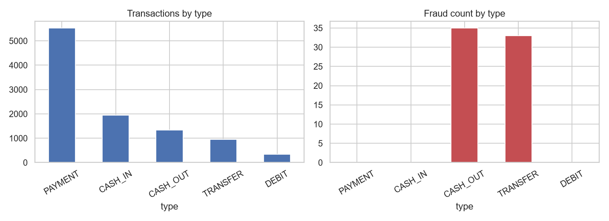
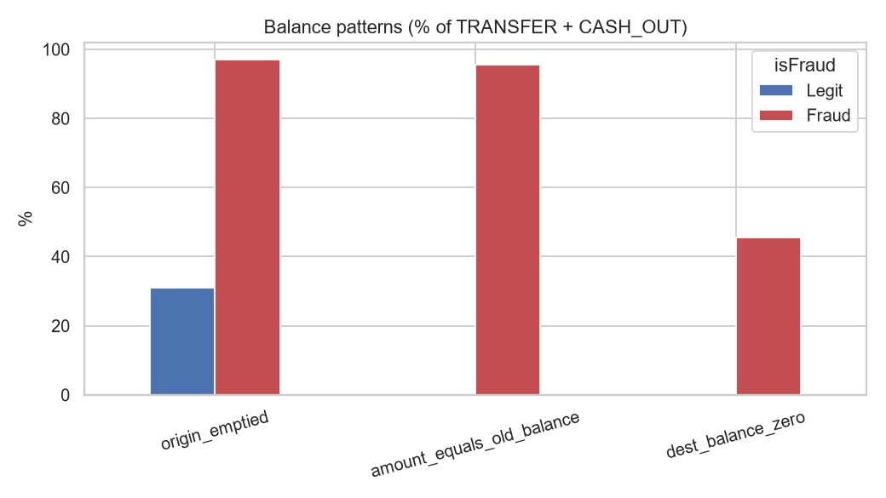
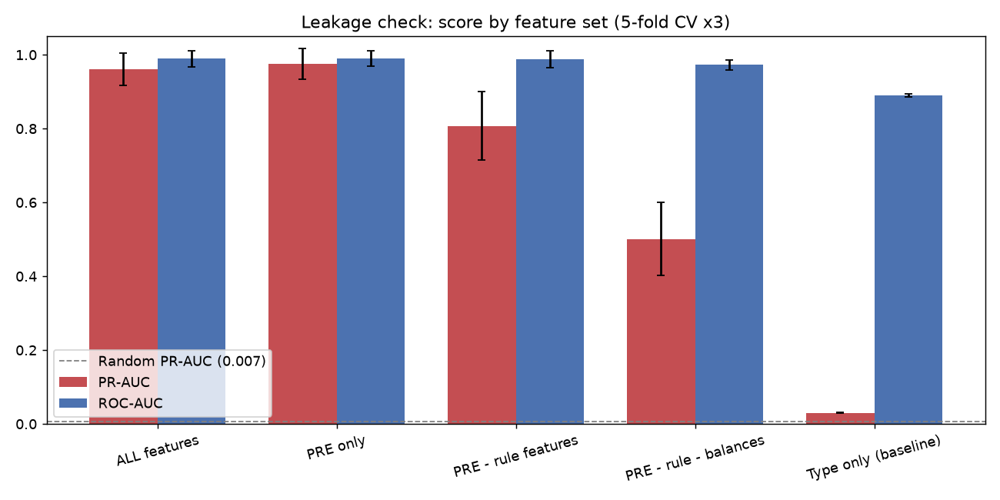
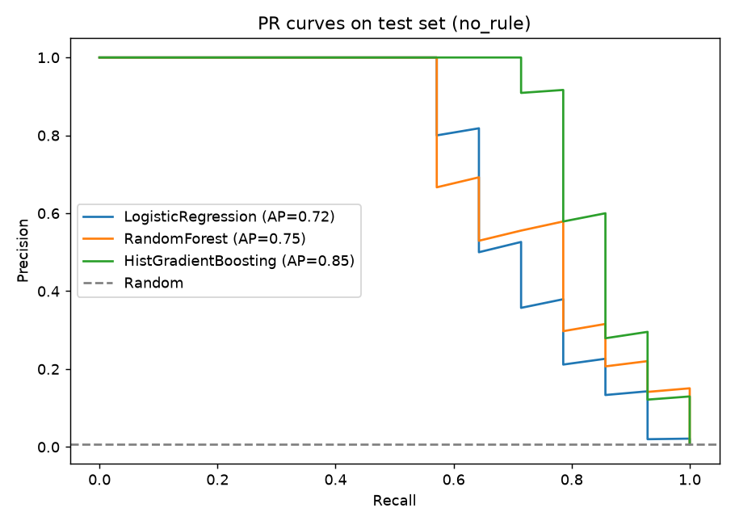
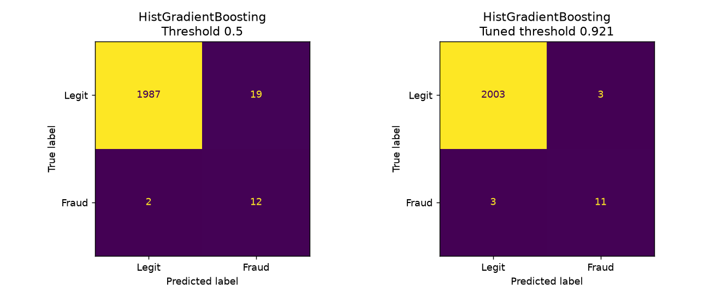

# Bank Transaction Fraud Detection

An end-to-end data analytics and machine learning project that detects fraudulent bank transactions in a highly imbalanced dataset (68 frauds in 10,099 transactions, 0.67%).

The project covers the full workflow: data inspection, cleaning, exploratory analysis, feature engineering, leakage analysis, model training with cross-validation, and evaluation on a held-out test set.

## Key Findings

- **Fraud is confined to two transaction types.** All 68 frauds are `TRANSFER` (33) or `CASH_OUT` (35). `PAYMENT`, `CASH_IN` and `DEBIT` contain no fraud.
- **One pattern explains almost everything.** In `TRANSFER` and `CASH_OUT` transactions, `amount == oldbalanceOrg` (the sender's entire balance is moved) flags 65 of the 68 frauds with zero false positives. The dataset therefore appears to be synthetic or rule-generated.
- **No dependence on post-transaction data.** Removing the `post_*` features (balances known only after the transaction) does not reduce performance, so the models are usable at decision time.
- **ROC-AUC is misleading here.** Transaction type alone gives ROC-AUC 0.89 but PR-AUC only 0.03, so PR-AUC is the primary metric.
- **Two model versions are reported** so that realistic difficulty is visible: `with_rule` (near-perfect scores) and `no_rule` (rule-revealing features removed).





## Results

### Leakage and signal check (5-fold CV repeated 3 times, gradient boosting)

| Feature set | PR-AUC | ROC-AUC |
|---|---|---|
| All features (including `post_*`) | 0.96 | 0.99 |
| PRE features only | 0.98 | 0.99 |
| PRE without rule features | 0.81 | 0.99 |
| PRE without rule features and balance columns | 0.50 | 0.97 |
| Transaction type only | 0.03 | 0.89 |
| Random guess | 0.007 | 0.50 |



### Test set (20% hold-out, 14 fraud cases)

| Version | Best model | Test PR-AUC | Frauds caught | False alarms |
|---|---|---|---|---|
| `with_rule` | Random Forest | 0.94 | 12 of 14 | 0 |
| `no_rule` | Histogram Gradient Boosting | 0.84 | 12 of 14 | 13 (tuned threshold) |





Full tables are in `reports/tables/` and all charts in `reports/figures/`.

## Methodology

1. **Inspect** the raw Excel file (shape, types, missing values, label problems).
2. **Clean**: remove 2 unreviewed labels and 26 rows with missing critical fields (no fraud case lost), drop redundant columns (target copy, constant flag, row id, duplicate day columns).
3. **Explore**: fraud by type, balance behaviour, amount, login, time and branch patterns.
4. **Engineer features** in two groups: `PRE` (known at decision time) and `post_` (known only after the transaction).
5. **Check leakage** by comparing five feature sets with the same model.
6. **Train** Dummy, Logistic Regression, Random Forest and Histogram Gradient Boosting with class weighting, 5-fold stratified CV on the training set only.
7. **Evaluate** once on the test set. The decision threshold is tuned on out-of-fold training predictions, not on the test set.

## Project Structure

```
FRAUD-DETECTION/
├── data/
│   ├── raw/Fraud_Detection.xlsx       original data (never edited)
│   └── processed/                     generated: clean_transactions.csv, features.csv
├── src/
│   ├── config.py                      paths and settings
│   ├── inspect_data.py                1. read-only inspection
│   ├── clean_data.py                  2. cleaning
│   ├── eda_analysis.py                3. charts and summary tables
│   ├── feature_engineering.py         4. PRE / post_ feature groups
│   ├── leakage_check.py               5. feature-set comparison
│   ├── train_model.py                 6. CV and training (two versions)
│   └── evaluate_model.py              7. test evaluation, threshold, importance
├── notebooks/                         exploratory notebooks
├── models/                            generated: saved models
├── reports/
│   ├── figures/                       charts
│   └── tables/                        summary tables
├── run_all.py                         runs the whole pipeline
└── requirements.txt
```

## Getting Started

Requires Python 3.10 or newer.

```bash
# 1. Clone the repository
git clone https://github.com/Theuttamjangid/fraud-detection.git
cd fraud-detection

# 2. Create and activate a virtual environment
python -m venv .venv
.venv\Scripts\activate          # Windows
# source .venv/bin/activate     # macOS / Linux

# 3. Install dependencies
pip install -r requirements.txt

# 4. Run the full pipeline
python run_all.py
```

To run a single step, execute the script directly, for example `python src/clean_data.py`. Run the scripts in the order listed above, because each step reads the previous step's output.

## Tech Stack

Python, pandas, NumPy, scikit-learn, matplotlib, seaborn, openpyxl, joblib.

## Limitations

- **Synthetic-looking data.** A single rule separates almost all fraud, so scores from the `with_rule` version reflect how easily that rule is learned, not real-world detection ability.
- **Very few fraud cases.** With 68 frauds overall and 14 in the test set, one missed fraud changes test recall by about 7 percentage points. Cross-validation results are more stable than test results.
- **Short time window.** The data spans about three weeks of January 2018, so seasonality and drift cannot be assessed.
- **No customer history.** Every sender ID is unique, so behavioural features per customer cannot be built.
- **False alarms.** In the `no_rule` version roughly half of all alerts are false, so the threshold should be set according to the cost of missed fraud versus manual review.

## Future Work

- Validate the approach on a larger real-world fraud dataset.
- Add customer-level behavioural features where transaction history exists.
- Tune hyperparameters with nested cross-validation.
- Calibrate predicted probabilities and choose the threshold using a cost-based criterion.

## Author

Uttam ([@Theuttamjangid](https://github.com/Theuttamjangid))
